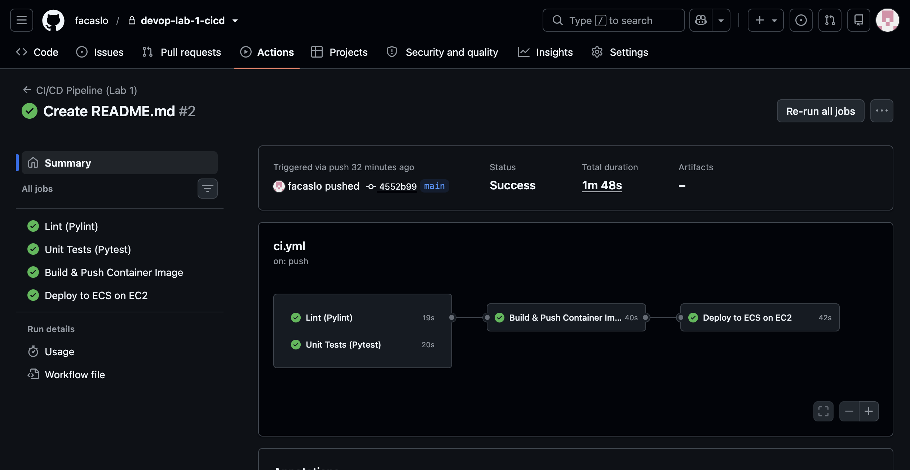
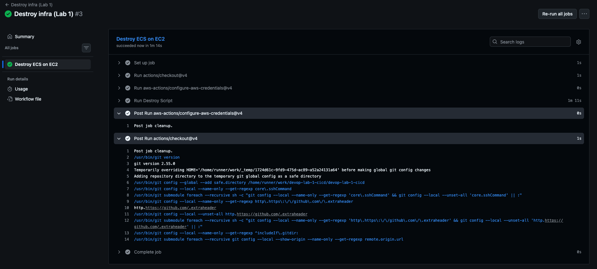
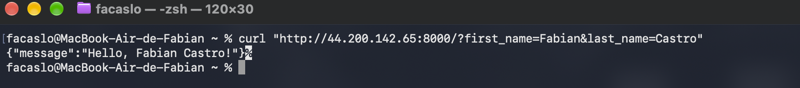
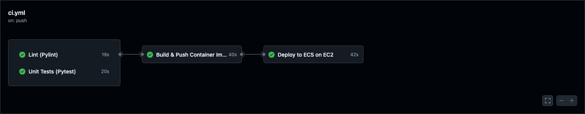

### Laboratorio 1 - Fundamentos de DevOps y SRE
##### Fabian Camilo Castro Lozano

---
**Enlace a repositorio:**
https://github.com/facaslo/devop-lab-1-cicd

##### Explicación de la arquitectura de contenedores y los conceptos de CI/CD aplicados al laboratorio. 

La aplicación consiste de un contenedor que corre un ambiente de python 3 con una API sencilla que recibe por query string el nombre y apellido del estudiante y devuelve en el body de respuesta un saludo.

Se implementa el concepto de integración continua, donde cada push o pull request a main ejecuta un análisis estático de código y una serie de pruebas unitarias, que corren en paralelo. Si se pasa el test entonces se sigue con la fase de construcción y subida de la imagen a AWS, finalmente se hace un rolling update como estrategia de despliegue contínuo, que hace que ECS utilice la última imagen construida.

Los scripts de aprovisionamiento son idempotentes, por lo que pueden correrse múltiples veces sin afectación. De igual manera se tiene un script de desaprovicionamiento idempotente. Se cuenta con una observabilidad básica con un endpoint /health y logs que se guardan en cloudwatch.

##### Evidencia visual de la ejecución exitosa del pipeline de GitHub Actions.
i. Pipeline automático para desplegar

ii. Pipeline manual para eliminar infraestructura

##### Evidencia visual de la petición HTTP a la IP pública de la instancia EC2 con Postman, Curl o el navegador.

##### Propuestas para mejorar el pipeline

En el pipeline actual se hace un análisis de código fuente con pylint, luego se corre un set de pruebas unitarias, para luego construir la imagen de docker y subirla al ECR de AWS y finalmente desplegarla en ECS.

En la fase de integración, se puede agregar una acción en github actions para verificar la seguridad de código, tal como verificación con bandit (https://bandit.readthedocs.io/en/latest/), y una de escaneo de imágenes como trivy (https://trivy.dev/) justo antes de subirlo al ECR. 

En cuanto a despliegue, se puede robustecer la estrategia implementando el pipeline solo sobre main y crear un pipeline independiente para un ambiente de pruebas con una rama independiente.

Revisando las acciones, la de desplieegue no hace un checkeo inicial de salud del servicio, por lo que el job puede ser satisfactorio, pero no necesariamente el servicio está en buena salud.

Los scripts de deploy y destroy son imperativos en bash, se pueden reemplazar por soluciones declarativas como terraform.